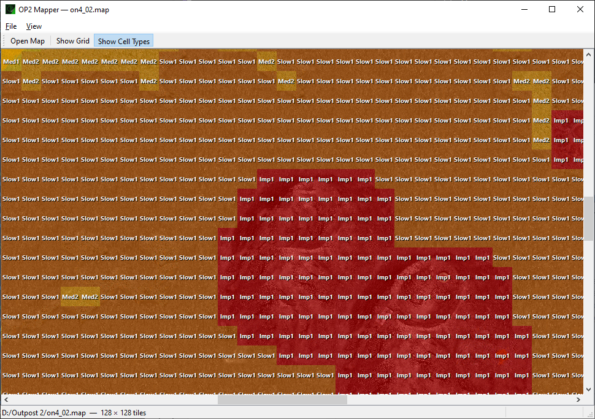

# OP2MapperQt

[](https://github.com/leviathan400/OP2MapperQt/actions/workflows/build.yml)



## What is it?

OP2MapperQt is a cross-platform map editor for Outpost 2: Divided Destiny. Create new maps, edit tile graphics and cell types, paint terrain and cliffs, work with tile groups, and export maps as images or JSON - a Qt/C++ port of [OP2Mapper3](https://github.com/leviathan400/OP2Mapper).

It requires an Outpost 2 (1.4.1) folder - select the root folder containing Outpost2.exe, and tile graphics are loaded automatically from the loose well BMP files in `OPU\base\tilesets` (or from the game's .vol archives).

## Download

Builds for Windows, macOS and Linux are on the [Releases](https://github.com/leviathan400/OP2MapperQt/releases) page:

- **Windows:** unzip and run `OP2MapperQt.exe` (64-bit; everything needed is in the folder).
- **macOS:** unzip and open `OP2MapperQt.app` (Apple silicon). The app isn't signed: the first time, right-click it and choose Open.
- **Linux:** `chmod +x` the `.AppImage` and run it (x86-64).

Settings are kept in `Mapper3.ini` next to the program.

## Features

**Current version: 0.7.0**, matching OP2Mapper3 0.7.0: the same tools, menus, messages and settings file.

### Terrain tools (via [op2maplib](https://github.com/OutpostUniverse/OP2MappingLib))
- **Terrain Brush** - paint mud, rock, sand or vegetation; borders blend with the game's own transition tiles. Brush size 3-25 (Ctrl+wheel). **Clean Up Transitions** redoes the transitions across the whole map.
- **Draw Cliff** - click points (they snap to cliff slopes), choose the high side and a wall height of 3-6, press Enter. Click the first point again for a closed plateau.
- **Find & Fix Enclosed Areas** - find passable areas units can never reach, highlight them, and make them impassable in one undoable step.

### Editing
- **Edit Mode** opens the tool windows: Tile Set, Cell Types, Tile Selection, Tile Groups, Mini Map and Terrain Brush
- **Tile and cell-type painting** (all 32 cell types), one tile per click (Single Tile Edit Mode) or drag painting
- **Copy and paste** - drag or two-click select; pastes bring cell types along (Edit > Paste Includes Cell Types)
- **Tile groups** - browse, preview and place (Ctrl+B); export a copy as a tile group (`.json` + `.bmp`), shared with OP2Mapper3 and [OP2TileGroupTools](https://github.com/leviathan400/OP2TileGroupTools)
- **Undo / redo** for every edit (500 steps); a whole drag or cliff is one step
- **New Map** from 10 bundled templates (64x64 up to 512x256), with an optional starting biome
- The bottom row keeps its Impassable cell type

### Viewing
- **Five render modes**, grid / large grid / coordinate overlays, configurable grid size
- **Zoom** 10%-150% with the mouse wheel (Ctrl+E locks it), right-drag panning
- **Sidebar** with map details, the map's tilesets and the selected tile
- **Mini map** with click-to-jump and drag-to-scroll

### Tool windows
They snap to each other and to screen edges, remember their positions across monitors, and can each be set to stay on top (right-click the title bar or press Alt+Space).

### Export and launch
- **Image export** at full size, 1/8 or 1/16, with or without grids; a combined **overview** of all render modes; **screenshot** of the view (F12)
- **Map JSON** export/import, compatible with [OP2MapJsonTools](https://github.com/leviathan400/OP2MapJsonToolsLibrary)
- **Launch Outpost 2**, launch it into the DLL picker (installs the bundled op2launcher), or open the game folder

### Safe by design
- Saves are written to memory, checked, then swapped in atomically; a failed save never damages the map
- A map that fails to open leaves the current one untouched
- Settings live in `Mapper3.ini` next to the program (the same file OP2Mapper3 uses); events are logged to `OP2Mapper.log`

## Keyboard shortcuts

| Keys | Action |
|---|---|
| Ctrl+N / Ctrl+O / Ctrl+S | New / open / save map |
| Ctrl+Z / Ctrl+Y | Undo / redo |
| Ctrl+C / Ctrl+V | Copy an area / paste (Edit Mode) |
| Ctrl+B | Place the selected tile group (Edit Mode) |
| Ctrl+G / Ctrl+L / Ctrl+D | Toggle grid / large grid / coordinates |
| Ctrl+E / Ctrl+R | Toggle zoom / reset zoom |
| Ctrl + mouse wheel | Terrain brush size |
| Enter / Backspace / Esc | Draw Cliff: place / remove last point / clear |
| Esc | Cancel paste, copy selection or tile-group placement |
| F12 | Screenshot |

## Command line

```
OP2MapperQt.exe [/op2dir "C:\Games\Outpost 2"] [map file]
```

`/op2dir` sets the Outpost 2 folder and skips the first-run prompt. A second launch hands its map to the running copy.

## Building

Qt 6 (Widgets, Network) and CMake 3.16+. Two libraries are needed:

- [OP2Utility](https://github.com/OutpostUniverse/OP2Utility) in `OP2Utility/` at the top of this repository (map and tileset file I/O)
- [OP2MappingLib](https://github.com/OutpostUniverse/OP2MappingLib) (op2maplib) checked out beside this repository as `OP2MappingLib/` or `op2maplib/`, or passed with `-DOP2MAPLIB_DIR=<path>`. It is built as a static library and its blend profile is embedded in the program.

```
cmake -S OP2Mapper -B build -DCMAKE_PREFIX_PATH=<path-to-Qt>
cmake --build build
```

Every push is built on Windows (MSVC), Linux (GCC) and macOS (Clang) by GitHub Actions ([`.github/workflows/build.yml`](.github/workflows/build.yml)), which checks out OP2Utility and OP2MappingLib at pinned commits. Each run keeps ready-to-run packages (Windows zip, macOS app bundle, Linux AppImage). Pushing a `v*` tag also creates a draft release with them attached. OP2Utility's upstream repository has no CMake files; the app's CMake builds its sources directly in that case.

A headless self-test of the editing core can be built with `-DOP2MAPPER_BUILD_SELFTEST=ON`. It needs an Outpost 2 install, and writes rendered images to the output folder:

```
QT_QPA_PLATFORM=offscreen QT_QPA_FONTDIR=C:/Windows/Fonts op2mapper_selftest "<Outpost 2 folder>" "<map file>" "<output folder>"
```

[ARCHITECTURE.md](ARCHITECTURE.md) describes how the code is organised.

## Related Projects

- [OP2Mapper3](https://github.com/leviathan400/OP2Mapper) - The VB.net map editor this port is based on
- [OP2MappingLib](https://github.com/OutpostUniverse/OP2MappingLib) - op2maplib: terrain blending, cliffs and passable regions
- [OP2TileGroupTools](https://github.com/leviathan400/OP2TileGroupTools) - Tile group JSON format reference
- [OP2MapJsonTools](https://github.com/leviathan400/OP2MapJsonToolsLibrary) - Map <-> JSON shared library
- [OP2Utility](https://github.com/OutpostUniverse/OP2Utility) - C++ library for working with OP2 files
